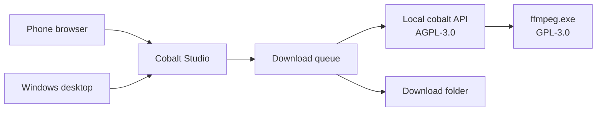

<p align="center">
  
</p>

<h1 align="center">Cobalt Studio</h1>

<p align="center">
  A self-hosted Windows studio for saving public media.<br>
  给 Windows 的自托管下载器：桌面、手机页面，以及本机的 cobalt。
</p>

<p align="center">
  <a href="LICENSE"></a>
  <a href="https://github.com/hurmuri/Cobalt-Studio/releases/latest"></a>
  
  <a href="UPSTREAM.json"></a>
  
</p>

<p align="center">
  <a href="https://github.com/hurmuri/Cobalt-Studio/releases/latest"><strong>Download for Windows</strong></a>
  &nbsp;·&nbsp;
  <a href="#run-from-source">Run from source</a>
  &nbsp;·&nbsp;
  <a href="#%E4%B8%AD%E6%96%87">中文</a>
  &nbsp;·&nbsp;
  <a href="THIRD-PARTY-NOTICES.md">Licenses</a>
</p>

Cobalt Studio is an independent desktop application. It starts a local [cobalt](https://github.com/imputnet/cobalt) 11.7.1 instance, a local web service, and FFmpeg. It does not use an account, and it does not call the public `api.cobalt.tools` service.

Paste a public link. The file is saved on this computer.

## Download

Windows 10 or 11, 64-bit, with the [WebView2 Runtime](https://developer.microsoft.com/microsoft-edge/webview2/) installed.

| File | What it is |
| --- | --- |
| [Cobalt-Studio-v1.0.19-win-x64.exe](https://github.com/hurmuri/Cobalt-Studio/releases/download/v1.0.19/Cobalt-Studio-v1.0.19-win-x64.exe) | One file. Copy it anywhere and run it. The first launch checks and unpacks its runtime. |
| [Cobalt-Studio-v1.0.19-win-x64.zip](https://github.com/hurmuri/Cobalt-Studio/releases/download/v1.0.19/Cobalt-Studio-v1.0.19-win-x64.zip) | Portable folder. Run `Cobalt Studio.exe` inside it. |
| [SHA256SUMS.txt](https://github.com/hurmuri/Cobalt-Studio/releases/download/v1.0.19/SHA256SUMS.txt) | Checksums for the release files. |

Standalone EXE SHA-256:

```text
b9eb0d9e582c31f379a23600ec59bde2453e785cb21cf22c919b962b8a0fb8b6
```

The default save location is `D:\downloads\cobalt`. Five downloads run at once. Both can be changed in Settings; concurrency accepts 1 through 10. Closing the window minimizes to the tray.

Tasks and settings for the standalone EXE live in `%LOCALAPPDATA%\Cobalt Studio\data`, not in the unpacked runtime cache. The portable folder keeps its own `.data` beside the executable.

## What you can do

- Paste a link and download with the saved defaults, or press Enter. Use New when the task needs different quality, audio, or several links.
- Watch the queue, then open a finished file in its folder.
- Read the source address. Public X posts can also show the author, text, and time. Older tasks are filled in on startup without downloading the video again.
- Show or hide media thumbnails. The switch applies to both the desktop and the phone.
- Open the phone page from a QR code. Choose the computer's real LAN IPv4 address, or its Tailscale address when both devices are on the same tailnet. Virtual adapters such as VMware are not offered.
- Use the system HTTP/HTTPS proxy for downloads.

The phone can submit, inspect, retry, and cancel tasks. It cannot change the save location or open folders on the computer. Output always uses the directory configured on the computer.

## Run from source

Install Git, Node.js 20 or newer, pnpm, and the .NET 10 SDK.

```powershell
git clone https://github.com/hurmuri/Cobalt-Studio.git
cd Cobalt-Studio
npm install
pwsh -NoProfile -File .\scripts\setup-cobalt.ps1
.\start.cmd
```

`setup-cobalt.ps1` fetches cobalt at the commit recorded in [`UPSTREAM.json`](UPSTREAM.json). It does not follow cobalt's default branch. Environment variables are documented in [`.env.example`](.env.example).

To build a release, use the only supported entry:

```powershell
pwsh -NoProfile -File .\scripts\release.ps1 -Bump patch
```

Each release directory contains the ZIP, the standalone EXE, a manifest, and `SHA256SUMS.txt`. Details are in [docs/RELEASING.md](docs/RELEASING.md).

## How it fits together



The desktop window is a WebView2 host around the local page. The phone uses the same queue. cobalt listens on this computer and is started and stopped with the app. FFmpeg is a separate program used to merge or transcode the result.

## Ethics

Cobalt Studio can only ask cobalt for content that is already public. It does not bypass a login, a paywall, or DRM. Some public posts still fail when the upstream service returns an empty response or an authorization error; that is a limitation, not a missing bypass.

You are responsible for what you download and how you use it. Do not publish this service to the internet. There is no account in front of it.

## License

Cobalt Studio is licensed under [AGPL-3.0-only](LICENSE). If you run a modified version and other people reach it over a network, the AGPL requires those people to be able to get the corresponding source. The desktop and phone pages link to this repository for that reason.

cobalt is also AGPL-3.0-only and remains copyrighted by imput and contributors. FFmpeg is GPL-3.0. GSAP and Cabinet Grotesk keep their own licenses and are not relicensed by this project. The complete attribution is in [THIRD-PARTY-NOTICES.md](THIRD-PARTY-NOTICES.md) and [NOTICE](NOTICE).

This project is not affiliated with imputnet.

## Contributing

Read [CONTRIBUTING.md](CONTRIBUTING.md) before opening a pull request. Bug reports and feature requests use the issue templates. Security reports go through [private advisories](https://github.com/hurmuri/Cobalt-Studio/security/advisories/new), not public issues. The community standard is the [Contributor Covenant](CODE_OF_CONDUCT.md).

## 中文

Cobalt Studio 是一个 Windows 下载器。它在本机启动 [cobalt](https://github.com/imputnet/cobalt)，不登录外部账号，也不使用官方 `api.cobalt.tools`。

当前公开版本是 1.0.19。需要 Windows 10 或 11 的 64 位系统，以及已安装的 WebView2 Runtime。

- 单独文件：[Cobalt-Studio-v1.0.19-win-x64.exe](https://github.com/hurmuri/Cobalt-Studio/releases/download/v1.0.19/Cobalt-Studio-v1.0.19-win-x64.exe)。放到任意目录即可运行，第一次启动会校验并解包。
- 便携目录：[Cobalt-Studio-v1.0.19-win-x64.zip](https://github.com/hurmuri/Cobalt-Studio/releases/download/v1.0.19/Cobalt-Studio-v1.0.19-win-x64.zip)。解压后运行其中的 `Cobalt Studio.exe`。
- 校验值见 [SHA256SUMS.txt](https://github.com/hurmuri/Cobalt-Studio/releases/download/v1.0.19/SHA256SUMS.txt)。独立 EXE 的 SHA-256 是 `b9eb0d9e582c31f379a23600ec59bde2453e785cb21cf22c919b962b8a0fb8b6`。

顶部输入公开链接，点击“下载”或按回车，就会按已保存的设置开始下载。“新建”用来批量输入或单独选择类型和画质。任务显示源地址；公开的 X 帖子可以补全作者、正文和时间。缩略图可以在设置里关闭。默认保存到 `D:\downloads\cobalt`，默认同时下载 5 个，可选 1 到 10 个。

手机和电脑在同一局域网，或同时加入同一 Tailscale 网络时，用右上角二维码打开手机页面。二维码只提供真实的局域网 IPv4 或 Tailscale 地址，不提供 VMware 这类虚拟网卡。手机可以提交和查看任务，不能修改电脑上的保存目录。不要把端口映射到公网：任何能打开这个地址的设备都能提交下载。

从源码运行需要 Git、Node.js 20 或更新版本、pnpm 和 .NET 10 SDK：

```powershell
npm install
pwsh -NoProfile -File .\scripts\setup-cobalt.ps1
.\start.cmd
```

`setup-cobalt.ps1` 会按 `UPSTREAM.json` 获取 cobalt 11.7.1 的指定提交，而不是跟踪上游默认分支。

本程序使用 AGPL-3.0-only。cobalt 同样是 AGPL-3.0，版权归 imput 及其贡献者。随包的 FFmpeg 是 GPL-3.0。GSAP 和 Cabinet Grotesk 字体保留各自的许可，没有因为放进这个仓库而变成 AGPL。完整说明见 [THIRD-PARTY-NOTICES.md](THIRD-PARTY-NOTICES.md)。

Cobalt Studio 与 imputnet 没有从属或授权关系。它只处理公开可访问的内容，不绕过登录、付费或 DRM。
